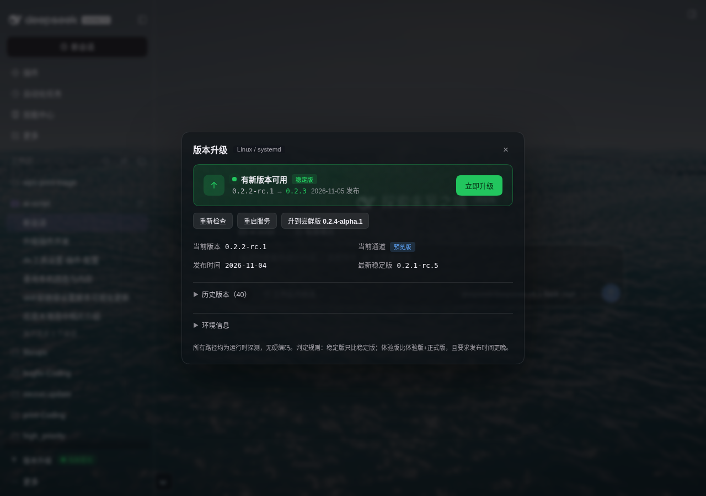
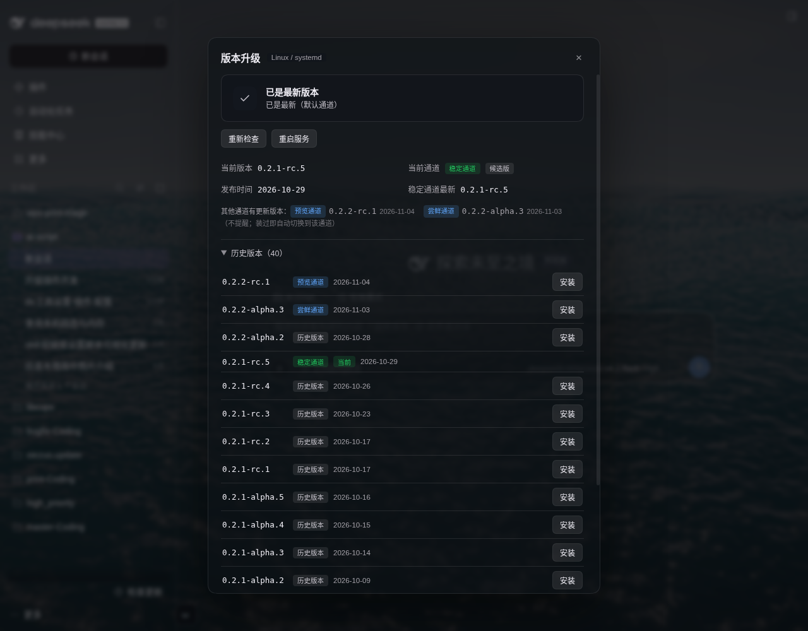
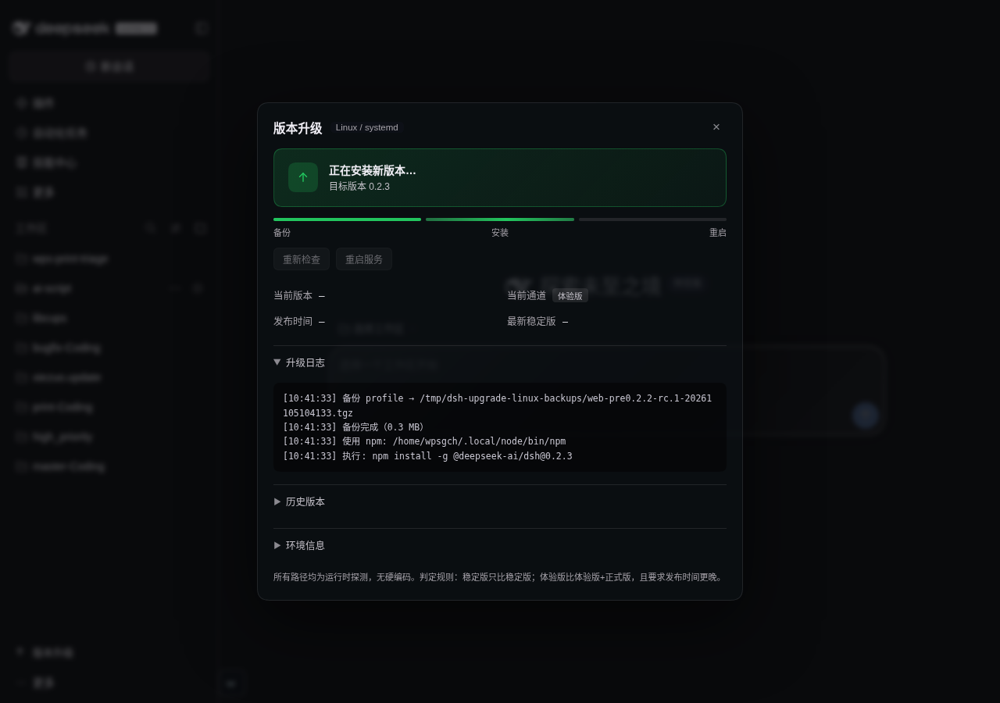

# dsh-upgrade-linux

DSH 版本检测与一键升级插件，**Linux 优先**，**零硬编码路径**。

参考 `dsh-upgrade@1.1.0` 的能力（版本检测 / 通道分流 / 备份 / 兼容性预检 / 一键升级 / 重启服务），
但把其中所有"只在作者 Mac 上成立"的假设改成了运行时探测。

## 为什么需要它

参考插件在 Linux 上有两处硬伤：

| 问题 | 参考插件 | 本插件 |
|---|---|---|
| 升级安装 | spawn 时重写 `PATH=/opt/homebrew/bin:/usr/local/bin:...`，导致 npm 落到系统前缀 `/usr/local` → **EACCES** | 继承原环境，前缀由 `npm root -g` 得出 |
| 服务重启 | 硬编码 `launchctl kickstart -k gui/$uid/com.deepseek.dsh.web`（macOS 专用）→ Linux 上 **spawn ENOENT 崩溃** | 从 `/proc/self/cgroup` 反查 systemd 单元 + MainPID 校验 |
| 升级记录 | 写死 `/Users/wonaren/XCCCC/...`、`/opt/homebrew` | 全部按 `os.homedir()` / `os.tmpdir()` 生成 |

## 探测逻辑（全部运行时得出，无写死路径）

| 项目 | 探测方式 |
|---|---|
| npm 可执行文件 | `dirname(process.execPath)/npm` → 逐项扫描 `PATH` |
| npm 全局前缀 | `<npm> root -g` |
| dsh 包目录 | `<全局前缀>/@deepseek-ai/dsh` |
| 当前版本 | 读上面目录里的 `package.json` |
| DSH_HOME | `$DSH_HOME` → `~/.dsh` |
| profile 名 | 命令行 `--profile` → `$DSH_PROFILE` → `profiles/` 下唯一目录 → `web` |
| 重启单元 | `/proc/self/cgroup` 里**最深**的 `.service`（排除 `user@*.service`），并用 `MainPID == process.pid` 校验 |
| 备份目录 | 配置项 `backupDir` → `os.tmpdir()/dsh-upgrade-linux-backups` |

探测结果可随时查看：`GET /api/dsh-upgrade-lx/env`


## 通道与更新判定

**通道只看 dist-tag，不看版本号里的后缀**（这一点之前是错的，已修）：

| dist-tag | 通道 | 含义 |
|---|---|---|
| `latest` | 稳定通道 | 默认 `npm i -g` 装到的版本 |
| `next` | 预览通道 | 下一个正式版的候选 |
| `alpha` | 尝鲜通道 | 最早的内测版本 |
| 不在任何 tag 上 | 历史版本 | 已经被覆盖的旧版本 |

版本号里的 `-rc` / `-alpha` 只描述「版本性质」（候选版 / Alpha），**不影响通道归属**。
所以 `0.2.1-rc.5` 是「稳定通道的候选版」——它确实是 rc，但它就是 latest 指向的版本。

| 你所在的通道 | 和谁比 | 提醒条件 |
|---|---|---|
| 稳定通道 | 只和 `latest` 比 | `latest` 比当前新且发布更晚 |
| 预览通道 | `latest` + `next` | 候选比当前新且发布更晚，取版本号最高 |
| 尝鲜通道 | `latest` + `next` + `alpha` | 同上 |

其他通道有新版本时**不提醒**，但面板会明确列出（带通道标签和日期），装一次即自动切换到该通道。

## 安装

```bash
dsh plugin --profile web add /path/to/dsh-upgrade-linux
systemctl --user restart dsh-web.service   # 或你自己的重启方式
```

## HTTP 接口

| 方法 | 路径 | 说明 |
|---|---|---|
| GET | `/api/dsh-upgrade-lx/env` | 环境探测结果（自检用） |
| GET | `/api/dsh-upgrade-lx/info` | 当前/最新/latest/next/alpha + 版本列表 |
| GET | `/api/dsh-upgrade-lx/compatibility?target=` | 已装插件的 engines 校验 |
| GET | `/api/dsh-upgrade-lx/status` | 升级任务状态与日志 |
| GET | `/api/dsh-upgrade-lx/ping` | 存活性探测（重启后自动重连用） |
| POST | `/api/dsh-upgrade-lx/upgrade` | body `{"target":"0.2.2-rc.1"}` |
| POST | `/api/dsh-upgrade-lx/restart` | 重启服务 |

## 升级流程

1. **备份** profile 目录（排除 `node_modules`）→ `.tgz`
2. **安装** `npm install -g @deepseek-ai/dsh@<target>`（继承环境，不重写 PATH）
3. **校验** 安装后磁盘上的真实版本
4. **重启** systemd 单元；非 systemd 托管时退化为退出进程并提示手动重启

## 与参考插件的行为差异

- 徽标**只对稳定版**亮起（参考插件会对 alpha 常态亮灯，长期挂着"有尝鲜版更新"）
- `latest` 严格取自 dist-tag `latest`（参考插件会把任何非 alpha/beta 的最高版本提升为 latest，例如把 `0.2.2-rc.1` 当成稳定版）
- 兼容性检查把"未声明引擎要求"的插件标记为 `null`（未知），而不是当作不兼容

## 注意

- `dsh plugin add` 用 `link:` 安装本目录，改代码后**重启 DSH** 即生效
- 备份目录在 `/tmp` 下，重启机器会清空；有需要请在配置里指定 `backupDir`

## 界面

侧栏入口：有更新时显示绿色呼吸圆点 + 「有新版本」徽标；无更新时只显示图标与文字。

| 有更新 | 已是最新 |
|---|---|
|  |  |

升级过程中显示「备份 → 安装 → 重启」三段进度条，日志实时滚动：



侧栏入口（有更新时）：


